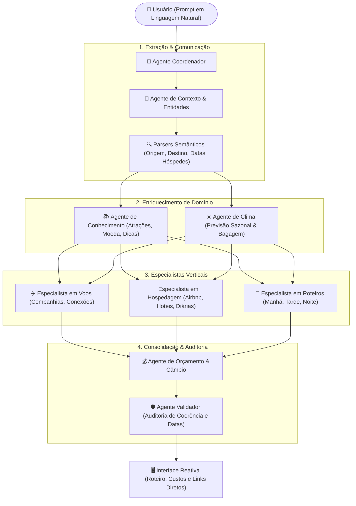

# Multi-Agent Travel System — Autonomous Trip Planning Architecture

[](https://react.dev/)
[](https://tailwindcss.com/)
[](https://nodejs.org/)
[](#-arquitetura-orquestração-dos-10-agentes)
[](https://www.framer.com/motion/)

Sistema inteligente de ponta a ponta para planejamento automatizado de viagens baseado em uma **arquitetura de múltiplos agentes colaborativos**. 

A partir de um único prompt em linguagem natural (ex: *"Quero viajar de João Pessoa para São Paulo de 11/08/2026 a 21/08/2026 para 3 pessoas em um Airbnb"*), o sistema orquestra uma malha de **10 agentes especializados** que extraem entidades, analisam condições climáticas, montam roteiros dinâmicos dia a dia, consolidam custos e geram links parametrizados de reserva para parceiros (como Kayak e Airbnb).

---

## 🏗️ Arquitetura: Orquestração dos 10 Agentes



---

## 🧠 Papéis e Responsabilidades dos Agentes

1. **🎯 Agente Coordenador (`coordenador.js`)**: O cérebro da operação. Avalia o prompt, distribui os dados e verifica se há requisitos mínimos antes de disparar o pipeline de execução.
2. **💬 Agente de Contexto (`agenteContexto.js`)**: Gerencia o diálogo com o usuário caso faltem dados essenciais, solicitando complementos de forma fluida.
3. **🔍 Parsers Semânticos de Entidades**: Algoritmos de NLP que isolam destinos, janelas temporais de viagem e quantidade de viajantes.
4. **📚 Agente de Conhecimento (`agenteConhecimento.js`)**: Base de dados turística para determinação de fusos horários, moedas locais, atrativos e recomendações de segurança.
5. **☀️ Agente de Clima (`agenteClima.js`)**: Avalia a sazonalidade nas datas especificadas, prevê temperaturas médias e gera sugestões de vestuário/bagagem.
6. **✈️ Especialista em Voos (`especialistaVoo.js`)**: Mapeia rotas aéreas domésticas e internacionais, aeroportos e precificação média.
7. **🏨 Especialista em Hospedagem (`especialistaHospedagem.js`)**: Segmenta as opções de acomodação conforme a preferência (Airbnb, resort, pousada ou hotel).
8. **📅 Especialista em Roteiros (`especialistaRoteiro.js`)**: Gera cronogramas diários detalhados (turnos: Manhã, Tarde e Noite) ajustados à duração da estadia.
9. **💰 Agente de Orçamento & Câmbio (`agenteOrcamento.js`)**: Converte moedas, valida limites orçamentários e constrói URLs parametrizadas com *deep-linking* de parceiros.
10. **🛡️ Agente Validador (`agenteValidador.js`)**: Executa a auditoria final de integridade (consistência de datas, valores e lógica do itinerário) antes da entrega.

---

## 🛠️ Stack Tecnológica

* **Frontend**:
  * **React 19**: Arquitetura baseada em componentes reativos.
  * **Vite**: Bundler de alta velocidade e compilação otimizada.
  * **Tailwind CSS v4**: Estilização utilitária com suporte a Glassmorphism e Dark Mode.
  * **Framer Motion**: Animações de transição de estado e micro-interações fluidas.
  * **Lucide React**: Ícones vetoriais modernos.
* **Backend**:
  * **Node.js & Express**: API REST assíncrona responsável pela orquestração dos agentes.

---

## 📁 Estrutura do Repositório

Multi-Agent-Travel-System/ ├── backend/ │ ├── src/ │ │ ├── agents/ # Implementação dos 10 agentes especializados │ │ ├── data/ # Base de conhecimento turístico e climatológico │ │ └── server.js # API REST Express │ └── package.json │ ├── src/ │ ├── components/ # Componentes visuais (Chat, Roteiro, Orçamento) │ ├── agents/ # Lógica de agentes no lado cliente │ ├── data/ # Bases estáticas e configurações │ ├── App.jsx # Ponto de entrada da aplicação │ └── index.css # Configurações de tema e Tailwind │ ├── vite.config.js └── package.json


---

## 🚀 Como Executar o Projeto

### Pré-requisitos
* [Node.js](https://nodejs.org/) instalado (versão 18 ou superior).

### 1. Clonar o Repositório
```bash
git clone https://github.com/caiodantass/Multi-Agent-Travel-System.git
cd Multi-Agent-Travel-System
```

### 2. Configurar o Backend
```bash
cd backend
npm install
node server.js
```

(O backend iniciará na porta 3001 ou configurada).

### 3. Configurar o Frontend

Abra um novo terminal na raiz do projeto:
```bash
npm install
npm run dev
```

Acesse a interface no navegador em [http://localhost:5173](http://localhost:5173).

---

## 👨‍💻 Autor

**Caio Dantas**  
* Engenheiro de Software / Desenvolvedor de Firmware  
* GitHub: [@caiodantass](https://github.com/caiodantass)  
* LinkedIn: [linkedin.com/in/caiodantass](https://www.linkedin.com/in/caio-l%C3%ADvio/)
